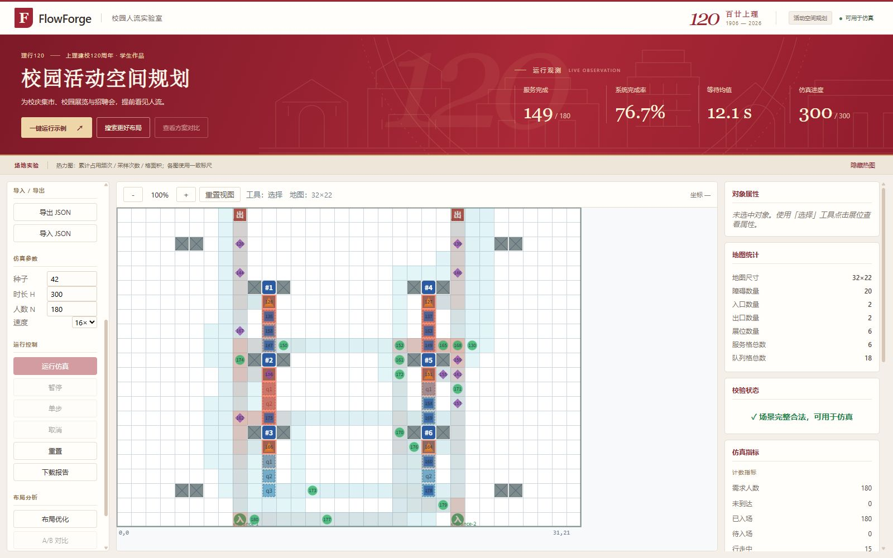

# FlowForge 校园人流实验室

面向招聘会、展览和校园活动的场景编辑、人流仿真与布局实验工具。团队：理行120；成员：裴家庆；公开昵称：Blu3_；版本：1.0。



源码仓库：https://atomgit.com/lOveZhao/FlowForge 。默认发布分支：`main`。

2026-10-27校庆版：主应用与展览页采用上理120周年主题的红金暖白配色，加入原创环形轨迹和校园建筑意象。最新运行截图与响应式检查见 `evidence/08_anniversary/`，交付ZIP以“校庆版”单独命名。

公开源码按下方“从源码运行”启动。完整交付包另含 `submission/展览页面/index.html` 与 `submission/离线体验/index.html`，交付材料不随公开源码仓库上传。离线版将前端程序内嵌在一个HTML中，不访问付费API、不需要服务器账户。浏览器自动化策略不允许访问 file 协议，因此本轮核验的是相同构建的本机HTTP版；直接双击的兼容性需在本机Chrome或Edge复核。

## 从源码运行

需要Node.js，已验证24.17.0。首次安装执行 `npm ci`，随后 `npm run dev -- --host 127.0.0.1`，打开终端给出的地址。Windows若PowerShell阻止npm脚本，使用 `npm.cmd`。

在 AI 开发者空间中启动预览使用 `npm run dev -- --host 0.0.0.0`，再按空间提示打开5173端口的预览页面。

```powershell
npm.cmd run typecheck
npm.cmd run test
npm.cmd run build
npm.cmd run simulate
```

## 使用

开发采用码道的分阶段工作流：先形成需求、方案和任务清单，再完成场景编辑、仿真主体与初版平滑动画。通过具体文件改动与运行反馈持续迭代，过程见 [码道开发过程](docs/DEVELOPMENT.md)。

1. 默认载入32×22、6展位招聘会场景，可绘制障碍、出入口，整体拖动展位，设置队列长度和服务时长。
2. 点击“一键运行示例”，按seed42、H300、N180以16×运行；可用1×观察、暂停、单步、切速及取消。
3. 显示热图检查累计密度。指标基于已提交模型时间步；动画仅改变显示坐标。
4. “搜索更好布局”枚举整体移动1–3格的合法展位包，固定训练11/29/47、留出83/101。搜索上限H300/N180/1600格/12展位，默认评估8个候选，最多12个。
5. A/B面板显示同需求的原始布局与训练候选，并明确是否采用。推荐布局只有通过留出门槛后可应用。可导出场景、完整仿真及对比JSON。

## 本次真实结果

- 类型检查、26个测试文件/324项测试、生产构建通过；68个模块。
- 默认仿真300步、924事件、149服务完成、138人离场；浏览器与headless核心逐字段一致。
- 搜索72个平移方案，32合法、40非法；实评8个，24个因预算跳过；33次仿真/9900步。
- 训练最佳候选未通过留出接受门槛，本次保留原布局。不能将等待单项降低写成整体改善。

本地完整交付包保留 `evidence/` 日志与 `runs/` 历史报告；这些大体积材料不随公开源码上传。执行 `npm run simulate` 可在本机重新生成默认运行报告；执行 `npx vitest run --config vitest.optimization.config.mjs` 可重新生成配对搜索报告。

## 材料与分工

完整交付包另含PPT、Word、码道使用证明、离线体验和展览材料。码道的需求、文件改动与阶段交付构成过程展示主线，实际协作范围集中记录在 [开发分工](docs/CONTRIBUTIONS.md)。

格点离散仿真与有限搜索原型，未标定现实人群行为，不用于应急疏散或安全认证。无全局最优保证；不同种子、时域、场景下可能没有改善。页面数据在内存中，关闭前应导出。
